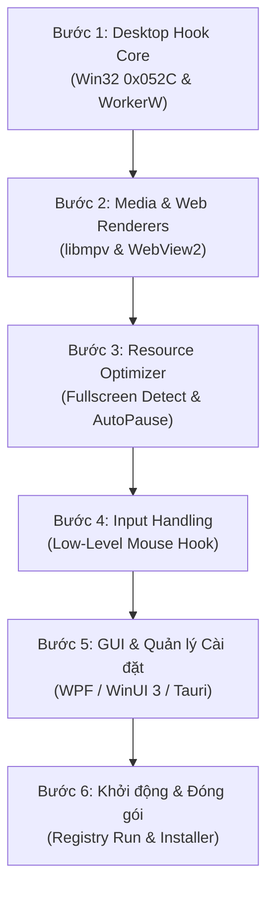

# PHÂN TÍCH KIẾN TRÚC AUTOWALL VÀ LỘ TRÌNH XÂY DỰNG ỨNG DỤNG LIVE WALLPAPER CHO WINDOWS

---

## MỤC LỤC
1. [Tổng Quan Hệ Thống AutoWall](#1-tổng-quan-hệ-thống-autowall)
2. [Phân Tích Kiến Trúc Kỹ Thuật (Under the Hood)](#2-phân-tích-kiến-trúc-kỹ-thuật-under-the-hood)
   - [Bí thuật Desktop Layering (WorkerW & Progman)](#21-bí-thuật-desktop-layering-workerw--progman)
   - [Phân tích chi tiết từng Module](#22-phân-tích-chi-tiết-từng-module)
3. [Lộ Trình Các Bước Xây Dựng Một Hệ Thống Tương Tự](#3-lộ-trình-các-bước-xây-dựng-một-hệ-thống-tương-tự)
   - [Bước 1: Xây dựng Module Hook Desktop (Core Engine)](#bước-1-xây-dựng-module-hook-desktop-core-engine)
   - [Bước 2: Xây dựng Bộ hiển thị nội dung (Media & Web Renderers)](#bước-2-xây-dựng-bộ-hiển-thị-nội-dung-media--web-renderers)
   - [Bước 3: Xây dựng Module Tối ưu hiệu năng & Pin (Resource Optimizer)](#bước-3-xây-dựng-module-tối-ưu-hiệu-năng--pin-resource-optimizer)
   - [Bước 4: Xử lý Tương tác Chuột & Bàn phím (Input Forwarder)](#bước-4-xử-lý-tương-tác-chuột--bàn-phím-input-forwarder)
   - [Bước 5: Xây dựng Giao diện Điều khiển (GUI & Quản lý cài đặt)](#bước-5-xây-dựng-giao-diện-điều-khiển-gui--quản-lý-cài-đặt)
   - [Bước 6: Khởi động cùng hệ thống & Đóng gói phát hành](#bước-6-khởi-động-cùng-hệ-thống--đóng-gói-phát-hành)
4. [Bảng So Sánh & Khuyến Nghị Công Nghệ Hiện Đại](#4-bảng-so-sánh--khuyến-nghị-công-nghệ-hiện-đại)

---

## 1. TỔNG QUAN HỆ THỐNG AUTOWALL

**AutoWall** là một tiện ích mã nguồn mở dạng Portable cho Windows, cho phép người dùng đặt video (MP4, MKV, WebM...), ảnh động (GIF), trang web cục bộ (HTML5/WebGL) hoặc link stream trực tuyến (YouTube) làm hình nền động trực tiếp trên màn hình máy tính.

Khác với các ứng dụng cồng kềnh như Wallpaper Engine hay Lively Wallpaper, AutoWall được thiết kế theo mô hình **Modular / Micro-tools Wrapper**: tận dụng các công cụ mã nguồn mở đã trưởng thành (`mpv`, `weebp`, `webview`) và kết nối chúng thông qua một chương trình điều phối trung tâm.

---

## 2. PHÂN TÍCH KIẾN TRÚC KỸ THUẬT (UNDER THE HOOD)

### 2.1. Bí thuật Desktop Layering (WorkerW & Progman)

Trong kiến trúc đồ họa thông thường của Windows Explorer:
- **Tầng dưới cùng**: Màn hình nền tĩnh (`Desktop Window`).
- **Tầng hiển thị icon**: Cửa sổ `Progman` (Program Manager) chứa `SHELLDLL_DefView` và `SysListView32` (các icon ngoài màn hình).

Nếu bạn chỉ tạo một cửa sổ toàn màn hình thông thường, nó sẽ che khuất toàn bộ icon desktop và thanh Taskbar. Để đưa cửa sổ phát video xuống **ngay sau icon và trên hình nền tĩnh**, AutoWall sử dụng kỹ thuật can thiệp Win32 API:

```
[Màn hình nền tĩnh Windows]
          │
          ▼
   [Cửa sổ WorkerW]  <── Nhúng MPV Video Player / WebView vào đây (SetParent)
          │
          ▼
 [SHELLDLL_DefView]  <── Chứa các Desktop Icon (vẫn bấm, kéo thả bình thường)
          │
          ▼
   [Taskbar & App]   <── Các cửa sổ làm việc thông thường
```

#### Cơ chế gọi API:
1. Tìm handle của tiến trình quản lý desktop:
   ```c
   HWND hProgman = FindWindow("Progman", NULL);
   ```
2. Gửi một message Win32 đặc biệt không có trong tài liệu chính thức (`0x052C`) tới `Progman`:
   ```c
   DWORD_PTR result;
   SendMessageTimeout(hProgman, 0x052C, 0, 0, SMTO_NORMAL, 1000, &result);
   ```
3. Lệnh này buộc Windows Explorer tạo ra một cửa sổ trung gian mang tên **`WorkerW`**.
4. Dùng `EnumWindows` để tìm `WorkerW` nằm ngay sau `SHELLDLL_DefView`.
5. Đổi cha của cửa sổ video (reparenting) để biến nó thành con của `WorkerW`:
   ```c
   SetParent(hRendererWindow, hWorkerW);
   ```

---

### 2.2. Phân tích chi tiết từng Module

Cấu trúc thư mục của AutoWall:

```
AutoWall/
├── AutoWall.exe         # GUI chính & Trình điều phối
├── config.ini           # Lưu trữ tùy chọn người dùng
├── mpv/                 # Bộ giải mã video hiệu năng cao
│   ├── mpv.exe
│   ├── mpv.conf
│   └── ...
├── weebp/               # Lớp hook ghim cửa sổ vào desktop
│   ├── wp.exe
│   ├── wp-headless.exe
│   └── weebp.dll
├── tools/               # Các công cụ phụ trợ thông minh
│   ├── autoPause.exe    # Tự động tạm dừng khi toàn màn hình
│   ├── mouseSender.exe  # Chuyển tiếp chuột vào wallpaper
│   ├── webview.exe      # Render trang web / HTML5
│   └── refresh.exe      # Làm mới desktop khi tắt/đổi hình nền
└── VideosHere/          # Thư mục mẫu chứa GIF, MP4, HTML, playlist
```

- **`AutoWall.exe`**: Quản lý vòng đời ứng dụng, đọc `config.ini`, tiếp nhận file từ người dùng, gọi các lệnh shell tương ứng với từng định dạng tệp.
- **`weebp` (`wp.exe`, `wp-headless.exe`)**: Nhận tham số là HWND hoặc tiến trình để nhúng vào `WorkerW`.
- **`mpv/`**: Trình phát đa phương tiện với cấu hình `mpv.conf`:
  - `hwdec=auto`: Bật tăng tốc phần cứng GPU để giảm tải CPU.
  - `loop=inf`: Lặp lại vô tận.
  - `border=no` & `force-window=yes`: Chạy không viền.
  - `volume=0`: Mặc định tắt tiếng để không gây phiền toái.
- **`autoPause.exe`**: Vòng lặp giám sát (`GetForegroundWindow` / `GetWindowRect`). Nếu cửa sổ đang active chiếm trọn độ phân giải màn hình (chơi game, xem video fullscreen), công cụ này sẽ tạm dừng tiến trình MPV để trả lại 100% tài nguyên cho game.
- **`mouseSender.exe`**: Lắng nghe sự kiện chuột trên vùng desktop trống và gửi lại tọa độ (`WM_MOUSEMOVE`, `WM_LBUTTONDOWN`) tới `webview.exe` để hình nền HTML có thể tương tác.
- **`refresh.exe`**: Kích hoạt `UpdatePerUserSystemParameters` hoặc làm mới Explorer khi thoát để dọn dẹp các khung hình rác của video cũ.

---

## 3. LỘ TRÌNH CÁC BƯỚC XÂY DỰNG MỘT HỆ THỐNG TƯƠNG TỰ



---

### Bước 1: Xây dựng Module Hook Desktop (Core Engine)
Mục tiêu là viết một thư viện (DLL) hoặc class trong C# / C++ / Rust để quản lý việc nhúng bất kỳ cửa sổ nào vào Desktop.

**Các hàm cần viết:**
1. `InitializeWorkerW()`: Gửi message `0x052C` đến `Progman`.
2. `GetWorkerWHandle()`: Duyệt `EnumWindows` để lấy đúng HWND của `WorkerW`.
3. `AttachWindow(HWND targetHwnd, RECT monitorBounds)`:
   - Chuyển `targetHwnd` thành cửa sổ con của `WorkerW` qua `SetParent(targetHwnd, hWorkerW)`.
   - Chỉnh lại Window Style: loại bỏ viền `WS_CAPTION`, `WS_THICKFRAME`.
   - Định vị kích thước phủ kín màn hình bằng `SetWindowPos`.
4. `DetachWindow(HWND targetHwnd)`: Phục hồi lại cửa sổ hoặc tắt hẳn, sau đó gọi làm mới hình nền mặc định.

---

### Bước 2: Xây dựng Bộ hiển thị nội dung (Media & Web Renderers)

Hệ thống cần 2 engine render:

1. **Bộ phát Video (Video Engine)**:
   - **Cách 1 (Khuyên dùng)**: Tích hợp thư viện `libmpv` trực tiếp vào mã nguồn ứng dụng (C/C++ hoặc wrapper C# như `Mpv.NET`). Cách này cho phép render trực tiếp lên một DirectX Surface, hiệu năng cao và điều khiển (pause/play/seek) tức thời qua API.
   - **Cách 2 (Mô hình AutoWall)**: Chạy tiến trình con `mpv.exe` độc lập với cờ:
     ```bash
     mpv.exe --player-operation-mode=pseudo-gui --force-window=yes --loop=inf --border=no --hwdec=auto "video.mp4"
     ```
     Sau đó lấy `HWND` của cửa sổ MPV vừa sinh ra để gọi `AttachWindow`.
2. **Bộ hiển thị Web (Web Engine)**:
   - Sử dụng **Microsoft Edge WebView2 SDK** (nhân Chromium có sẵn trên Windows 10/11).
   - Tạo một cửa sổ WebView borderless, cho phép nạp đường dẫn cục bộ (ví dụ: `file:///C:/wallpaper/index.html`) hoặc URL trực tuyến.

---

### Bước 3: Xây dựng Module Tối ưu hiệu năng & Pin (Resource Optimizer)

Hình nền động không được làm chậm máy tính của người dùng khi làm việc nặng.

1. **Phát hiện ứng dụng toàn màn hình (Fullscreen Detection)**:
   - Dùng vòng lặp kiểm tra định kỳ (mỗi 500ms):
     ```c
     HWND fgWnd = GetForegroundWindow();
     GetWindowRect(fgWnd, &fgRect);
     ```
   - So sánh kích thước `fgRect` với kích thước màn hình lấy từ `GetMonitorInfo`.
   - Nếu bằng hoặc lớn hơn màn hình (Game, video YouTube fullscreen, PowerPoint trình chiếu): Gửi lệnh `pause` tới video player / đóng băng vòng lặp animation của WebView.
   - Khi người dùng thoát toàn màn hình: Gửi lệnh `resume`.
2. **Hỗ trợ đa màn hình (Multi-monitor)**:
   - Dùng `EnumDisplayMonitors` để lấy danh sách màn hình và toạ độ hiển thị.
   - Cho phép người dùng tùy chọn: Chạy 1 video trải dài trên tất cả màn hình (Span), nhân bản (Duplicate), hoặc mỗi màn hình một video riêng biệt.

---

### Bước 4: Xử lý Tương tác Chuột & Bàn phím (Input Forwarder)

Mặc định khi click vào Desktop, hệ điều hành chỉ tương tác với lớp icon. Để hình nền HTML phản hồi chuột:

1. Cài đặt **Low-level Mouse Hook**:
   ```c
   HHOOK hMouseHook = SetWindowsHookEx(WH_MOUSE_LL, LowLevelMouseProc, hInstance, 0);
   ```
2. Trong hàm callback `LowLevelMouseProc`:
   - Dùng `WindowFromPoint` kiểm tra xem con trỏ chuột có đang nằm trên vùng desktop trống hay không.
   - Nếu đúng, chuyển tiếp message chuột (`WM_MOUSEMOVE`, `WM_LBUTTONDOWN`, `WM_LBUTTONUP`, `WM_MOUSEWHEEL`) tới HWND của WebView2 thông qua `PostMessage`.

---

### Bước 5: Xây dựng Giao diện Điều khiển (GUI & Quản lý cài đặt)

Xây dựng ứng dụng quản lý trực quan cho người dùng:
1. **Giao diện người dùng**:
   - Thư viện hình nền (danh sách tệp video, ảnh gif, web kèm thumbnail preview).
   - Nút bật/tắt âm thanh (Mute/Volume slider).
   - Thiết lập tự động dừng khi chạy pin (Battery Saver) hoặc khi chạy ứng dụng toàn màn hình.
2. **Khay hệ thống (System Tray)**:
   - Chạy ngầm dưới System Tray (góc dưới bên phải).
   - Nhấp chuột phải để mở menu nhanh: *Pause/Resume*, *Next Wallpaper*, *Mute*, *Settings*, *Exit*.
3. **Lưu trữ cấu hình**:
   - Sử dụng định dạng `settings.json` để lưu trữ trạng thái người dùng.

---

### Bước 6: Khởi động cùng hệ thống & Đóng gói phát hành

1. **Tự khởi động cùng Windows**:
   - Ghi đường dẫn ứng dụng vào Registry:
     `HKEY_CURRENT_USER\Software\Microsoft\Windows\CurrentVersion\Run`
2. **Dọn dẹp khi thoát (Cleanup)**:
   - Bắt sự kiện thoát ứng dụng (`WM_CLOSE`, `WM_DESTROY`, `AppDomain.ProcessExit`).
   - Hủy bỏ các process con (`mpv`, `webview`).
   - Gọi `SystemParametersInfo(SPI_SETDESKWALLPAPER, 0, NULL, SPIF_SENDCHANGE)` để khôi phục lại hình nền tĩnh nguyên bản của người dùng mà không để lại màn hình đen.
3. **Đóng gói**:
   - Tạo file cài đặt tự động bằng **Inno Setup** hoặc **WiX Toolset**, hoặc đóng gói dạng Portable zip.

---

## 4. BẢNG SO SÁNH & KHUYẾN NGHỊ CÔNG NGHỆ HIỆN ĐẠI

| Module | Giải pháp của AutoWall | Khuyến nghị công nghệ mới | Lợi thế giải pháp mới |
| :--- | :--- | :--- | :--- |
| **Ngôn ngữ chính** | AutoIt / C++ Wrapper | **C# (.NET 8/9)** hoặc **Rust / C++** | Hiệu năng cao, type-safe, dễ bảo trì và mở rộng. |
| **Giao diện (UI)** | AutoIt Form cơ bản | **WinUI 3** hoặc **WPF Fluent** | Giao diện hiện đại theo chuẩn Fluent Design của Windows 11. |
| **Desktop Hook** | Gọi qua tiến trình `wp.exe` (weebp) | Win32 P/Invoke gọi trực tiếp | Không phụ thuộc file `.exe` ngoài, chống báo nhầm virus (False-positive Antivirus). |
| **Trình phát Video** | Gọi tiến trình `mpv.exe` ngoài | Tích hợp **`libmpv`** hoặc **`Flyleaf`** | Giao tiếp API nội bộ mượt mà, không giật lag khi chuyển đổi video. |
| **Trình duyệt Web** | `webview.exe` | **Microsoft.Web.WebView2** | Rất nhẹ, bảo mật cao, cập nhật theo trình duyệt Edge của Windows. |
